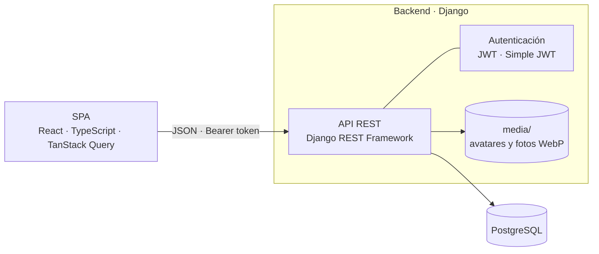
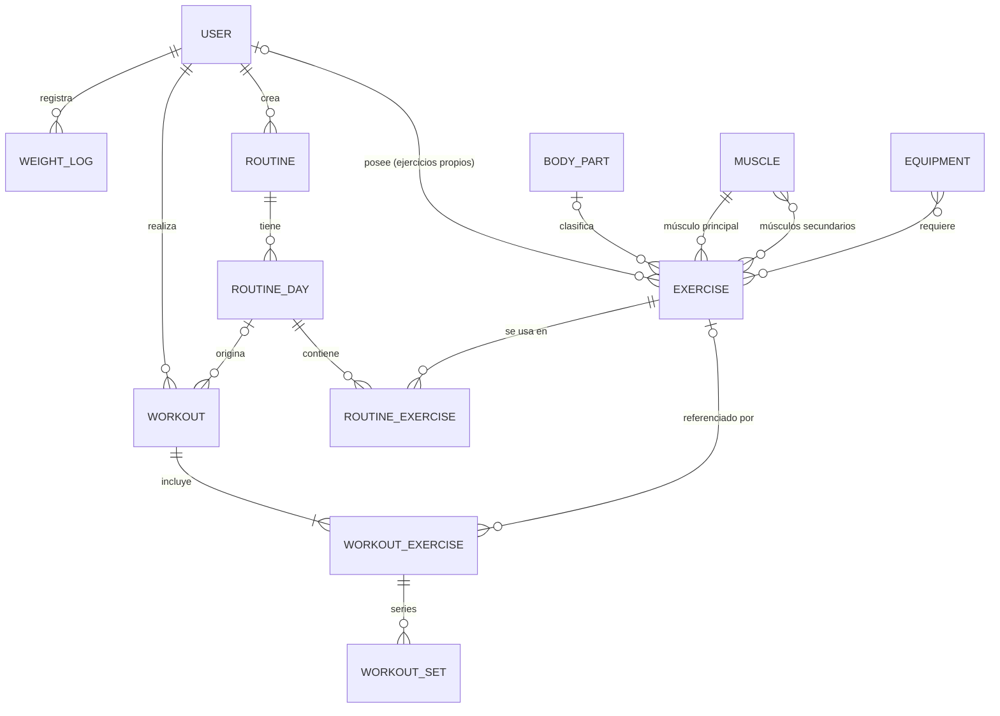

# EZTraining

Aplicación web para planificar rutinas de gimnasio, registrar cada entreno serie a serie y seguir tu progreso: volumen, récords y peso corporal.


<!-- TODO: badge de licencia cuando se añada un archivo LICENSE -->
<!-- TODO: badge de estado del build cuando haya CI en .github/workflows -->

## 🎬 Demo

<!-- TODO: añadir captura o GIF del flujo principal (crear rutina → entrenar → resumen) -->

> [!NOTE]
> Demo en vivo: la aplicación todavía no está desplegada.

## 📖 Sobre el proyecto

EZTraining es un cuaderno de entrenamiento digital. Defines una rutina (días, y en cada día ejercicios con series objetivo, rango de repeticiones, RIR y descanso), la empiezas desde el móvil o el ordenador, anotas peso y repeticiones de cada serie con temporizador de descanso y, al terminar, obtienes un resumen de la sesión. La pantalla de inicio te dice qué entreno te toca y cómo vas en la semana.

Es el proyecto final del Máster en Desarrollo Web Full Stack y, además, lo uso personalmente para llevar mis entrenos.

### Decisiones técnicas

- **Lógica en servicios, vistas finas.** Las reglas de negocio viven en `services.py` (`workouts`, `routines`, `dashboard`), separadas de las vistas y los serializers, y se prueban de forma aislada.
- **El entreno es un registro histórico.** Al empezar un entreno se copian los datos de la rutina a `Workout`, `WorkoutExercise` y `WorkoutSet`, incluidos los nombres. Borrar o editar después una rutina o un ejercicio no altera lo ya entrenado (`SET_NULL` + nombre copiado).
- **Un solo entreno activo por usuario.** Se garantiza con una transacción y `select_for_update`, también frente a dos peticiones simultáneas. Al empezar otro, el anterior se guarda si tenía progreso o se descarta si estaba vacío.
- **Datos aislados por usuario.** Cada consulta se filtra por propietario y los permisos comprueban la pertenencia. El catálogo de ejercicios es común y cada usuario puede añadir los suyos, visibles solo para él.
- **Agregados calculados en la base de datos.** Volumen, series completadas y récords salen de `annotate`/`Sum`, no de bucles en Python.
- **Autenticación JWT con rotación.** Token de acceso de 15 minutos y de refresco de 7 días, con rotación y lista negra tras el uso. El interceptor de Axios renueva el acceso de forma transparente.
- **Imágenes optimizadas al subirlas.** Se valida tipo y tamaño (máx. 5 MB), se corrige la rotación EXIF, se redimensionan y se guardan en WebP con nombre aleatorio.
- **Búsqueda sin acentos** de ejercicios con la extensión `unaccent` de PostgreSQL.
- **Tests sin dependencias externas.** La suite usa SQLite y almacenamiento de archivos en memoria, así que no necesita PostgreSQL ni ensucia `media/`.

## ✨ Características principales

- **Rutinas** con días y ejercicios configurables (series, repeticiones mínimas y máximas, RIR objetivo, descanso) y asistente paso a paso para crearlas.
- **Entreno en vivo** a partir de un día de rutina: series ya creadas, cronómetro, temporizador de descanso y comparación con la última vez que hiciste ese mismo ejercicio.
- **Resumen e historial** de entrenos con duración, series completadas y volumen total.
- **Panel de inicio** con entrenos de la semana frente al objetivo, volumen semanal, próximo entreno, peso actual y objetivo, y récords de pecho, espalda y pierna.
- **Catálogo de ejercicios** con ficha (instrucciones, músculos, material), filtros por músculo, equipamiento y origen, y búsqueda sin acentos.
- **Ejercicios propios** con foto, editables y borrables sin perder tu historial.
- **Perfil** con registro de peso, gráfico de evolución, foto, altura y peso objetivo.
- **Navegación pensada para móvil**, con menú inferior y paneles deslizantes.

## 🛠️ Tecnologías

| Capa | Tecnologías |
| --- | --- |
| **Frontend** | React 19, TypeScript 6, Vite 8, React Router 7, TanStack Query 5, Axios, Tailwind CSS 4, lucide-react |
| **Backend** | Python 3.12, Django 6.1, Django REST Framework 3.18, Simple JWT 5.5, django-filter, drf-nested-routers, django-cors-headers, Pillow |
| **Base de datos** | PostgreSQL (desarrollado sobre Supabase), con la extensión `unaccent` |
| **Herramientas de desarrollo** | ESLint, django-debug-toolbar, django-extensions |
| **Testing** | Django `TestCase` / DRF `APITestCase` sobre SQLite: 148 tests de backend |

## 🏗️ Arquitectura



<details>
<summary>Modelo de datos</summary>



</details>

## 🚀 Primeros pasos

### Requisitos previos

- **Python 3.12** o superior
- **Node.js 20.19+ o 22.12+** (requisito de Vite 8; probado con 24.14)
- **PostgreSQL**, con permisos para crear la extensión `unaccent` (la crea una migración)

### Instalación

```bash
git clone https://github.com/Gpasadasfj/EZTraining.git
cd EZTraining
```

**Backend**

```bash
cd backend
python -m venv .venv
source .venv/bin/activate        # En Windows: .venv\Scripts\activate
pip install -r requirements.txt
cp .env.example .env             # y rellena las variables (ver tabla)
python manage.py migrate
python manage.py loaddata catalog   # catálogo inicial de ejercicios
mkdir -p media/exercises && cp exercises/fixtures/images/*.webp media/exercises/
python manage.py createsuperuser # opcional: acceso a /admin/
python manage.py runserver
```

La API queda en `http://localhost:8000/api/`. Ejecuta siempre los comandos desde `backend/`: es donde se busca el archivo `.env`.

**Frontend**, en otra terminal:

```bash
cd frontend
npm install
echo "VITE_API_URL=http://localhost:8000/api/" > .env
npm run dev
```

La aplicación queda en `http://localhost:5173`. El backend solo acepta peticiones desde `localhost:5173` y `127.0.0.1:5173`.

> [!IMPORTANT]
> `VITE_API_URL` debe terminar en `/`: el cliente concatena las rutas a esa URL.

### Variables de entorno

**Backend** (`backend/.env`, plantilla en `backend/.env.example`)

| Variable | Descripción | Ejemplo |
| --- | --- | --- |
| `DJANGO_SECRET_KEY` | Clave secreta de Django. También firma los JWT. Obligatoria, incluso para los tests. | cadena larga y aleatoria |
| `DEBUG` | Con el valor exacto `True` activa Debug Toolbar, django-extensions, la autenticación por sesión en la API y el servido de `/media/`. Cualquier otro valor lo desactiva. | `True` |
| `DB_NAME` | Nombre de la base de datos | `postgres` |
| `DB_USER` | Usuario de PostgreSQL | `postgres` |
| `DB_PASSWORD` | Contraseña de PostgreSQL | `tu-contraseña` |
| `DB_HOST` | Host de PostgreSQL | `localhost` |
| `DB_PORT` | Puerto de PostgreSQL | `5432` |

Para generar una clave secreta:

```bash
python -c "from django.core.management.utils import get_random_secret_key as g; print(g())"
```

**Frontend** (`frontend/.env`)

| Variable | Descripción | Ejemplo |
| --- | --- | --- |
| `VITE_API_URL` | URL base de la API, con `/` final | `http://localhost:8000/api/` |

### Catálogo de ejercicios

Tras `migrate` el catálogo está vacío, y sin él no se puede crear una rutina ni un ejercicio propio (el músculo es obligatorio). El repositorio incluye el catálogo inicial como fixture: 6 grupos corporales, 13 músculos, 7 equipamientos y 43 ejercicios con instrucciones en español e inglés (`backend/exercises/fixtures/catalog.json`), junto con sus imágenes en WebP (`backend/exercises/fixtures/images/`).

Los dos comandos del bloque de instalación hacen lo siguiente: `loaddata` crea las filas en la base de datos, pero no copia archivos, así que las imágenes se copian aparte a `media/exercises/`. Sin ese segundo paso la app funciona, pero muestra un icono de mancuerna en lugar de la foto de cada ejercicio.

> [!WARNING]
> Carga el fixture una sola vez y en una base de datos nueva, antes de crear ejercicios propios. Usa claves primarias fijas, así que sobrescribiría cualquier fila existente con el mismo `id`, y volver a ejecutarlo restaura el catálogo a los valores del fixture.

Los récords del panel de inicio buscan los grupos corporales con slug `chest`, `back` y `legs`, que ya vienen en el fixture.

## 💻 Uso

### Flujo en la aplicación

1. Regístrate (con foto de perfil opcional) e inicia sesión.
2. En **Rutinas**, crea una con el asistente: nombre, días y ejercicios de cada día.
3. Desde el panel de inicio o desde la rutina, pulsa **Empezar entreno** en un día. Anota peso, repeticiones y RIR de cada serie; el temporizador de descanso arranca al completarlas.
4. Al terminar verás el resumen, y el entreno quedará en **Entrenos**.
5. En **Perfil** registra tu peso para ver su evolución, y en **Ejercicios** añade los tuyos si no están en el catálogo.

### API

Todas las rutas cuelgan de `/api/`, devuelven JSON y exigen `Authorization: Bearer <access>`, salvo el registro y el login. Las listas van paginadas de 10 en 10, salvo `muscles/` y `equipment/`.

| Recurso | Método y ruta | Descripción |
| --- | --- | --- |
| Auth | `POST /token/` | Login: devuelve `access` y `refresh` |
| | `POST /token/refresh/` | Renueva el acceso (y rota el refresh) |
| | `POST /users/register/` | Registro, en JSON o `multipart` con `avatar` |
| | `POST /users/logout/` | Invalida el token de refresco |
| Perfil | `GET` · `PATCH /users/me/` | Consulta y edita el perfil |
| | `PUT` · `DELETE /users/me/avatar/` | Sube o quita la foto |
| | `GET` · `POST /users/weight-logs/` | Historial y alta de peso |
| | `DELETE /users/weight-logs/{id}/` | Borra un registro de peso |
| Inicio | `GET /dashboard/` | Métricas de la semana, próximo entreno y récords |
| Ejercicios | `GET` · `POST /exercises/` | Lista (con `search`, `muscle`, `body_part`, `equipment`, `secondary_muscles`, `custom`) y alta de ejercicio propio |
| | `GET /exercises/muscles/` · `equipment/` | Listas para los filtros |
| | `GET` · `PUT` · `PATCH` · `DELETE /exercises/{slug}/` | Ficha; editar y borrar, solo los propios |
| | `PUT` · `DELETE /exercises/{slug}/image/` | Foto de un ejercicio propio |
| Rutinas | `/routines/` | CRUD de rutinas |
| | `/routines/{id}/days/` | CRUD de días |
| | `/routines/{id}/days/{day}/exercises/` | CRUD de ejercicios del día |
| Entrenos | `POST /workouts/` | Empieza un entreno con `{"routine_day": <id>}` |
| | `GET /workouts/active/` | Entreno en curso (o `null`) |
| | `POST /workouts/{id}/finish/` | Termina el entreno |
| | `GET /workouts/history/` | Entrenos terminados |
| | `GET /workouts/{id}/summary/` | Resumen con totales y series completadas |
| | `GET` · `PATCH /workouts/{id}/exercises/{ex}/` | Ejercicio del entreno |
| | `GET /workouts/{id}/exercises/{ex}/previous/` | Series de la última vez que lo hiciste |
| | `GET` · `PATCH /workouts/{id}/exercises/{ex}/sets/{set}/` | Lista y edición de series |

Ejemplo de uso con `curl`:

```bash
# Login
curl -X POST http://localhost:8000/api/token/ \
  -H "Content-Type: application/json" \
  -d '{"username": "tu_usuario", "password": "tu_contraseña"}'

# Ejercicios del catálogo que contienen «press», sin los propios
curl "http://localhost:8000/api/exercises/?search=press&custom=false" \
  -H "Authorization: Bearer <access>"

# Empezar el entreno del día de rutina 1
curl -X POST http://localhost:8000/api/workouts/ \
  -H "Authorization: Bearer <access>" \
  -H "Content-Type: application/json" \
  -d '{"routine_day": 1}'
```

## 📁 Estructura del proyecto

```text
EZTraining/
├── backend/                 # API REST (Django + DRF)
│   ├── config/              # settings, urls raíz, wsgi y asgi
│   ├── core/                # compartido: procesado de imágenes, permisos y mixins
│   ├── users/               # usuario, registro, perfil, avatar y registros de peso
│   ├── exercises/           # catálogo de ejercicios y ejercicios propios
│   │   └── fixtures/        # catálogo inicial (catalog.json) e imágenes WebP
│   ├── routines/            # rutinas → días → ejercicios
│   ├── workouts/            # entreno en vivo, series, historial y resumen
│   ├── dashboard/           # métricas agregadas del panel de inicio
│   ├── manage.py
│   ├── requirements.txt
│   └── .env.example
└── frontend/                # SPA (React + Vite)
    └── src/
        ├── api/             # llamadas a la API (Axios) y cliente con refresco de token
        ├── components/      # componentes agrupados por dominio
        ├── hooks/           # hooks de TanStack Query y utilidades
        ├── layouts/         # AuthLayout y AppLayout
        ├── pages/           # pantallas: inicio, ejercicios, rutinas, entrenos, perfil
        ├── routes/          # ProtectedRoute
        ├── services/        # login, logout y almacenamiento de tokens
        ├── types/           # tipos de TypeScript de la API
        └── utils/           # formato y helpers
```

Cada app de Django guarda sus tests en una carpeta `test/`.

## 🧪 Tests

```bash
cd backend
python manage.py test              # toda la suite: 148 tests
python manage.py test workouts     # solo una app
```

Los tests usan SQLite y guardan los archivos en memoria, así que no necesitan PostgreSQL. Solo requieren un `.env` con `DJANGO_SECRET_KEY`.

El frontend todavía no tiene tests automatizados. Para comprobar que compila y pasa el tipado:

```bash
cd frontend
npm run build
```

## 🌐 Despliegue

Todavía no hay despliegue ni configuración de producción: `ALLOWED_HOSTS` está vacío, los orígenes CORS son los de desarrollo y `/media/` solo se sirve con `DEBUG=True`. En producción, el servidor web (nginx, Caddy…) tendrá que servir la carpeta `media/`, que incluye tanto las imágenes del catálogo como las fotos que suban los usuarios.

## 🗺️ Roadmap

- [ ] Preparar la configuración de producción (`ALLOWED_HOSTS`, CORS y archivos estáticos y de medios)
- [ ] Desplegar la aplicación y publicar la demo
- [ ] Integración continua con GitHub Actions (tests de backend y build del frontend)
- [ ] Tests automatizados del frontend
- [ ] Comando `seed_demo` con usuarios y datos de prueba (ya reservado en `.env.example`)
- [ ] Añadir un archivo `LICENSE`

## 📄 Licencia

<!-- TODO: elegir una licencia y añadir el archivo LICENSE -->
El repositorio todavía no incluye un archivo de licencia.

## 👤 Autor

**Javier García** · [GitHub](https://github.com/Gpasadasfj) · <!-- TODO: añadir enlace a LinkedIn -->
